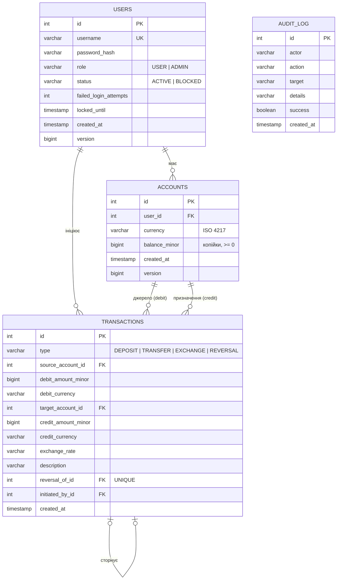
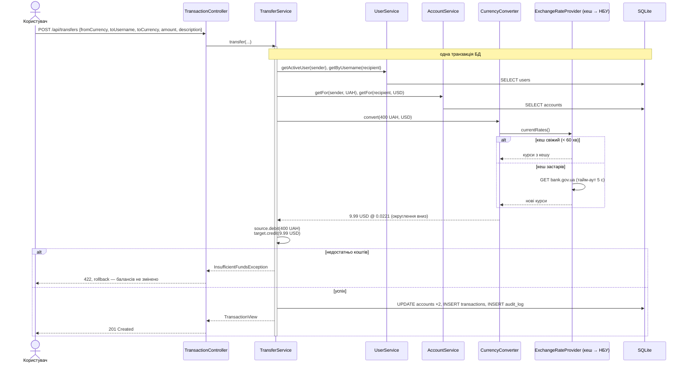

# SDD — JFinanceManager

Software Design Document для теми «Фінансова система з обліком транзакцій»: таблиці
рахунків і транзакцій (тип, сума, дата, опис), обчислення балансу рахунку.

## 1. Мета і контекст

Сервер із REST API, який веде облік грошей користувачів у кількох валютах. Кожна зміна
балансу фіксується незмінним записом у журналі транзакцій, тому баланс будь-якого рахунку
можна перерахувати з журналу й звірити зі збереженим.

**Ролі:**
- `USER` — має рахунки, переказує гроші, дивиться історію та виписки;
- `ADMIN` — поповнює рахунки, блокує користувачів, призначає ролі, сторнує транзакції,
  переглядає аудит.

**Обмеження:** Java 21, Maven, SQLite (через JDBC, Hibernate/JPA), один вузол.

## 2. Функціональні вимоги

| ID | Вимога |
|---|---|
| FR-1 | Користувач реєструється й входить за логіном і паролем; пароль зберігається лише як хеш. |
| FR-2 | Користувач має рахунки в кількох валютах (не більше одного на валюту); рахунок у UAH відкривається під час реєстрації. |
| FR-3 | Адміністратор поповнює рахунок; це єдиний спосіб внести гроші в систему. |
| FR-4 | Користувач переказує гроші іншому користувачу з необов'язковим описом; списання й зарахування відбуваються атомарно. |
| FR-5 | Переказ між рахунками в різних валютах (зокрема обмін між власними рахунками) конвертується за офіційним курсом НБУ. |
| FR-6 | Користувач бачить історію транзакцій (тип, сума, дата, опис) за період і вивантажує виписку у CSV або JSON. |
| FR-7 | Система обчислює баланс рахунку з журналу транзакцій і звіряє його зі збереженим балансом. |
| FR-8 | Адміністратор блокує/розблоковує користувачів, змінює ролі, сторнує транзакції й переглядає журнал аудиту. |

## 3. Нефункціональні вимоги

| ID | Вимога | Як перевіряється |
|---|---|---|
| NFR-1 Точність | Розбіжність між збереженим балансом і балансом, обчисленим із журналу, — **0 копійок** після **20** одночасних переказів; суми зберігаються цілими числами в мінімальних одиницях, конвертація ніколи не зараховує більше, ніж списано (округлення вниз до 0,01). | `ConcurrencyAndLedgerIntegrationTest`, `CurrencyConverterTest` |
| NFR-2 Безпека | Паролі — Argon2id; після **5** невдалих спроб входу поспіль акаунт блокується на **15 хв**; сесія завершується після **15 хв** неактивності; пароль від **8** символів (літера + цифра). | `AuthIntegrationTest`, `DomainModelTest` |
| NFR-3 Залежність від НБУ | До API НБУ — не більше **1** запиту на **60 хв** (кеш); тайм-аут HTTP **5 с**; якщо НБУ недоступний, використовується останній отриманий курс. | `CachingExchangeRateProviderTest` |

## 4. Definition of Done для FR-4 (переказ)

FR-4 вважається закритою, коли:
1. `POST /api/transfers` списує суму з рахунку відправника й зараховує її отримувачу **в одній
   транзакції БД** разом із записом журналу та записом аудиту.
2. Відхиляються з кодом і зрозумілим повідомленням:
   - сума ≤ 0 або з більш ніж 2 знаками після коми → 400;
   - порожні або відсутні поля → 400;
   - нестача коштів → 422, **жоден** баланс не змінився;
   - переказ на той самий рахунок → 422;
   - заблокований відправник → 403, заблокований отримувач → 422;
   - отримувач не має рахунку у валюті → 404.
3. Межовий випадок: переказ **усього** балансу проходить, баланс стає рівно 0.
4. Опис переказу зберігається й читається з БД без змін; відсутній опис не ламає переказ.
5. Тест паралельних переказів (NFR-1) зелений.
6. `mvn clean verify` зелений: тести, Checkstyle — 0 порушень, SpotBugs — 0 помилок,
   покриття рядків ≥ 70 %.
7. Ендпоінт описаний у README.

## 5. Модель даних

Журнал `transactions` **append-only**: записи не змінюються й не видаляються, помилку
виправляє новий запис `REVERSAL`.

## 6. Головний сценарій: переказ із конвертацією

## 7. Архітектура

Пакети за функціональністю (`auth`, `user`, `account`, `transaction`, `exchange`, `admin`,
`audit`, `common`). Контролери → сервіси → репозиторії (інтерфейси Spring Data).
Бізнес-правила, що стосуються однієї сутності, живуть у самій сутності
(`Account.debit` не допускає від'ємного балансу).

Заплановані патерни (обґрунтування — у README):

| Група | Патерн | Де |
|---|---|---|
| Породжувальний | Builder | `AuditEntry.builder()` — запис аудиту з кількома рядковими полями |
| Структурний | Adapter | `NbuExchangeRateProvider` — API НБУ → інтерфейс `ExchangeRateProvider` |
| Структурний | Decorator | `CachingExchangeRateProvider` — кеш і fallback поверх будь-якого провайдера |
| Поведінковий | Strategy | `StatementExporter` — формати виписки CSV / JSON |

## 8. Ризики

| Ризик | Ймовірність / вплив | Що робимо |
|---|---|---|
| Помилки округлення (`double`) спотворюють баланси | висока / критичний | Гроші — `BigDecimal` у коді, `long` копійок у БД; заборона більш ніж 2 знаків після коми; тести на межі округлення. |
| Гонка: два одночасні перекази списують той самий баланс | середня / критичний | Атомарні транзакції БД; SQLite з одним з'єднанням у пулі серіалізує запис; `@Version`; тест 20 паралельних переказів. |
| Половинчастий переказ (списали, але не зарахували) | низька / критичний | Списання, зарахування, журнал і аудит в одній `@Transactional`; тест відкату при нестачі коштів. |
| НБУ недоступний або повільний | середня / середній | Тайм-аут 5 с, кеш 60 хв, fallback на останній курс, інакше 503 з поясненням. |
| Підбір паролів | середня / високий | Argon2id, блокування після 5 спроб на 15 хв, аудит невдалих входів. |
| Хтось навмисно блокує чужий акаунт невдалими входами | низька / низький | Блокування тимчасове (15 хв); задокументовано як компроміс. |
| Секрети в репозиторії | середня / високий | Пароль першого адміна лише зі змінної середовища або генерується; у тестах — випадковий; `.gitignore` для БД, логів, `target/`, `.idea/`. |
| Обсяг завдання не вкладається в термін | висока / середній | Пріоритизація MoSCoW: спершу FR-1…FR-4, далі решта. |
